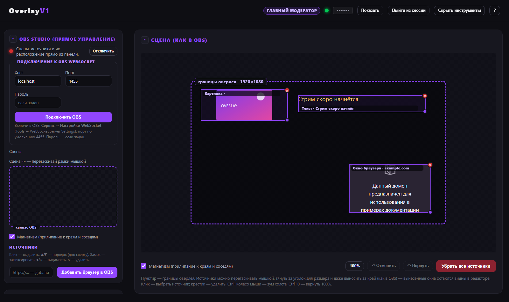
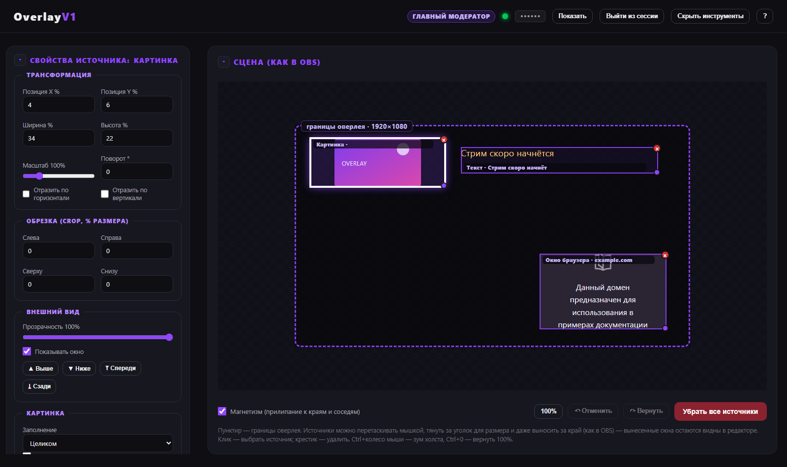
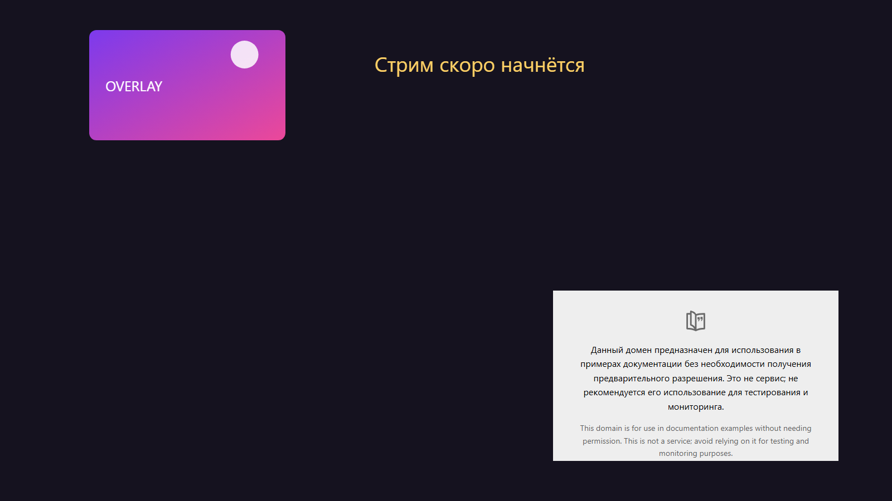
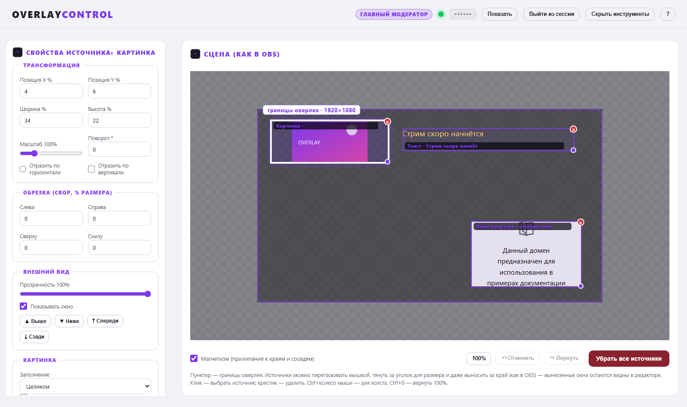

<div align="center">

# Overlay Control

**Панель модератора для Twitch-оверлеев: картинки, видео, сайты, текст, TTS и прямое управление OBS.**

[](LICENSE)


</div>

---

## Что это

Своя мини-OBS для модератора: веб-панель, где источники добавляются, двигаются и
масштабируются мышкой прямо на превью сцены, а OBS показывает результат в реальном
времени. Работает локально, без облака и подписки.



<details>
<summary>Свойства источника · Оверлей в OBS · Светлая тема</summary>

**Свойства источника** — всё настраивается на месте:


**Оверлей в OBS** — прозрачный фон, всё видно как в сцене:


**Светлая тема панели:**


</details>

## Возможности

**Сцена**
- Живое превью оверлея: рамки источников тянутся мышкой, тянутся за уголок (размер),
  удаляются крестиком — как в OBS.
- Типы источников: **картинка/GIF**, **видео** (громкость, зацикливание), **сайт/браузер**
  (iframe), **текст** (свой текст, размер и цвет — отдельное окно без URL).
- У каждого источника: прозрачность, поворот, отражение по осям, обрезка, z-порядок.
- У картинок — режим вписывания (contain/cover/stretch) и **удаление фона (chroma key)**.
- Привязка к сцене, отмена/возврат действий (Ctrl+Z / Ctrl+Shift+Z), зум холста.
- Пресеты сцены: сохранить набор источников и переключаться между ними в один клик.
- Импорт/экспорт `config.json`, чтобы перенести сцену на другой комп.

**OBS Studio**
- Прямое управление через obs-websocket: сцены, переключение сцены, список источников
  на сцене, включение/выключение источников.
- Автопереподключение при смене пароля.

**Озвучка (TTS)**
- StreamElements (бесплатно) и ElevenLabs (свой голос) — на выбор.
- Текст алерта можно показывать на оверлее поверх сцены.

**Роли и доступ**
- Три роли с разными правами и своими токенами: панель открывается по ссылке с токеном.

| Право | head | moderator | streamer |
|---|:---:|:---:|:---:|
| Сцены, источники, пресеты | ✅ | ✅ | — |
| Озвучка TTS | ✅ | ✅ | ✅ |
| Управление OBS | ✅ | ✅ | — |
| Настройки (config.json) | ✅ | — | — |

**Ещё**
- Тёмная и светлая тема панели.
- Готовый установщик для Windows (NSIS) + запуск из исходников одной командой.
- Панель открывается с любого устройства в локальной сети.

## Быстрый старт

### Установщик (Windows)

1. Скачай `Overlay Control Setup.exe` из [Releases](../releases).
2. Запусти и установи.
3. Приложение само поднимет сервер и откроет панель.

### Из исходников

```bash
npm install
npm start
```

Или двойной клик по `start.bat` (Windows). В консоли появятся ссылки:

```
Оверлей (добавить в OBS):   http://localhost:3000/overlay
Панель модератора:          http://localhost:3000/control?t=<токен>
В локальной сети:           http://192.168.0.13:3000/control?t=<токен>   (Wi-Fi)
```

### Linux и Docker

Сервер — обычный Node.js, на Linux запускается как есть.

**Docker (удобно для VPS):**

```bash
git clone https://github.com/dem0st/twitch-overlay.git
cd twitch-overlay
docker compose up -d
```

Панель: `http://<IP-сервера>:3000/control?t=<токен>`, токен лежит в `data/.token`.
Без compose:

```bash
docker build -t overlay-control .
docker run -d --name overlay -p 3000:3000 -v "$(pwd)/data:/data" overlay-control
```

**Напрямую на Linux:**

```bash
git clone https://github.com/dem0st/twitch-overlay.git
cd twitch-overlay
npm install --omit=dev
node server.js
```

или `./start.sh` — скрипт сам поставит зависимости.

**Системный сервис systemd** — готовый юнит в [`deploy/twitch-overlay.service`](deploy/twitch-overlay.service):

```bash
sudo cp deploy/twitch-overlay.service /etc/systemd/system/
sudo systemctl enable --now twitch-overlay
```

Если OBS стоит на другом компьютере — в источнике «Браузер» указывай адрес сервера:
`http://<IP-сервера>:3000/overlay`.

### Подключение в OBS

1. Источники → **+** → **Браузер**
2. URL: `http://localhost:3000/overlay`
3. Разрешение: **1920×1080** (или своё разрешение сцены)
4. Прозрачность фона включится сама — галочку «Прозрачный фон» ставить не нужно

## Настройка

| Что | Где |
|---|---|
| Ключ StreamElements | Панель → «Ключи TTS» (JWT-токен из раздела API-токенов канала) |
| Ключ ElevenLabs | Панель → «Ключи TTS» → API-ключ с elevenlabs.io |
| Пароль OBS | OBS → Сервис → Настройки WebSocket → панель → «OBS Studio» |
| Роли и токены | Панель → «Роли и доступ» |
| Импорт старой сцены | Панель → «Настройки (config.json)» → Импортировать config.json |

Подробная памятка по каждому ключу — на странице **«Открыть → Справка»** в панели.

## Доступ из локальной сети

Панель работает на всех интерфейсах, поэтому с телефона или другого компа в той же
Wi-Fi сети достаточно открыть ссылку из консоли (`В локальной сети: ...`). Токен
доступа — в ссылке, в файле `.token` и в самой панели (кнопка «Показать токены»).

Для доступа из интернета — туннель, например:

```bash
cloudflared tunnel --url http://localhost:3000
```

> Токены — это единственное, что защищает панель. Не публикуй `.token` и `tokens.json`,
> не ставь панель в интернет без HTTPS-туннеля.

## Конфигурация

Всё хранится рядом с приложением (для установленной версии — `%APPDATA%\twitch-overlay`):

| Файл | Что внутри |
|---|---|
| `config.json` | сцена, порт, канал, настройки OBS и TTS |
| `.token` | токен главного (head) |
| `tokens.json` | токены модератора и стримера |
| `presets.json` | пресеты сцены |

Переменные окружения:

| Переменная | Что делает |
|---|---|
| `PORT` | порт сервера (по умолчанию 3000) |
| `CONTROL_TOKEN` | токен главного (head) |
| `OVERLAY_DATA_DIR` | папка с данными |
| `STREAMELEMENTS_TOKEN` | ключ StreamElements для TTS |
| `ELEVENLABS_API_KEY` | ключ ElevenLabs для TTS |

Пример конфига — [`config.example.json`](config.example.json).

## Команды консоли

В окне сервера доступны:

| Команда | Что делает |
|---|---|
| `help` | список команд |
| `links` | ссылки на оверлей и панель (в т.ч. по локальной сети) |
| `token` | показать токены |
| `status` | состояние сервера, источников и OBS |
| `sources` | список источников на сцене |
| `netcheck` | проверить, отвечает ли сервер по адресам локальной сети |
| `clear` | очистить консоль |
| `reboot` | перезапустить сервер |
| `exit` | остановить сервер |

## Разработка

```bash
npm install
npm start        # сервер + панель на :3000
npm run desktop  # десктопное приложение (Electron)
npm run dist     # сборка установщика Windows → dist/
npm run dist:linux   # сборка AppImage + deb для Linux (нужен Linux)
```

Стек: Node.js + Express + Socket.IO, фронтенд — ванильный HTML/CSS/JS, десктоп —
Electron, сборка — electron-builder (NSIS / AppImage / deb).

Структура:

```
server.js              сервер, API, Socket.IO, консольные команды
public/overlay.html    страница для OBS (Browser Source)
public/control.html    панель модератора
public/help.html       памятка по настройке
electron/main.js       обёртка Electron
build/                 иконки приложения
Dockerfile             сборка образа для Linux
docker-compose.yml     запуск в один docker compose up
deploy/                systemd-юнит
start.sh / start.bat   запуск в один клик
```

## Лицензия

MIT — см. [LICENSE](LICENSE). Ключи StreamElements/ElevenLabs и OBS WebSocket
используются по их собственным условиям.
